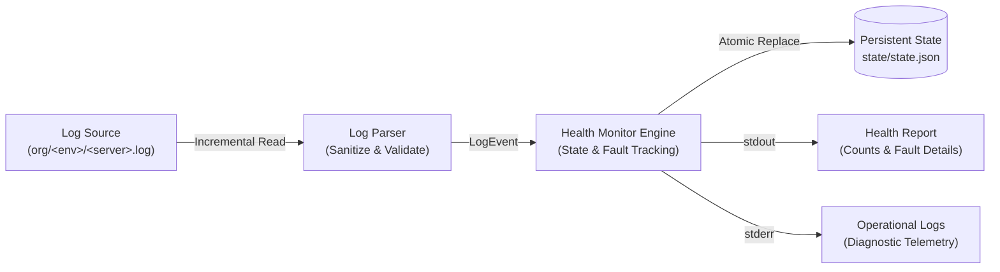
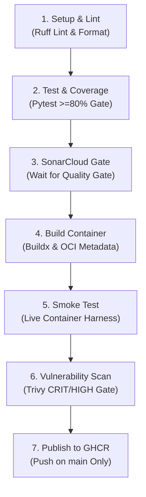
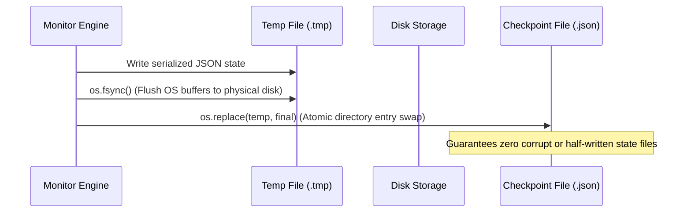

# Server Health Monitor

[](https://www.python.org/downloads/)
[](https://github.com)
[](https://github.com/astral-sh/ruff)
[](Dockerfile)
[](https://sonarcloud.io)
[](https://ghcr.io)

A lightweight, production-grade Python daemon and CLI tool that continuously scans server log streams (`org/<environment>/<server>.log`), tracks stateful server fault lifecycles, and outputs structured health reports. Active faults persist across scans and service restarts until explicitly cleared by an authorized resolution line in the same log file.

---

## Table of Contents

- [1. Architecture & Key Features](#1-architecture--key-features)
- [2. Project Structure](#2-project-structure)
- [3. Getting Started](#3-getting-started)
  - [Prerequisites](#prerequisites)
  - [Local Installation](#local-installation)
- [4. Execution & Operations](#4-execution--operations)
  - [Single-Scan Mode (`--once`)](#single-scan-mode---once)
  - [Continuous Monitoring Loop](#continuous-monitoring-loop)
  - [Exit Code Contract](#exit-code-contract)
- [5. Configuration Reference](#5-configuration-reference)
- [6. Log Format & Resolution Specification](#6-log-format--resolution-specification)
  - [Log Event Grammar](#log-event-grammar)
  - [Resolution Event Syntax](#resolution-event-syntax)
  - [Lifecycle Walkthrough](#lifecycle-walkthrough)
- [7. Quality Assurance & Testing](#7-quality-assurance--testing)
  - [Running Tests & Coverage Gate](#running-tests--coverage-gate)
  - [Static Analysis & Formatting](#static-analysis--formatting)
  - [Container Smoke Tests](#container-smoke-tests)
- [8. Containerization & Docker](#8-containerization--docker)
  - [Building the Image](#building-the-image)
  - [Running the Container](#running-the-container)
  - [Non-Root Security Model](#non-root-security-model)
- [9. CI/CD Pipeline & Quality Gates](#9-cicd-pipeline--quality-gates)
  - [Pipeline Flow](#pipeline-flow)
  - [Stage Breakdown](#stage-breakdown)
  - [GitHub Secrets & Variables Configuration](#github-secrets--variables-configuration)
  - [SonarCloud Integration](#sonarcloud-integration)
  - [GHCR Publishing Permissions](#ghcr-publishing-permissions)
- [10. Resilience & Architecture Decisions](#10-resilience--architecture-decisions)
  - [Atomic Persistence & Crash Recovery](#atomic-persistence--crash-recovery)
  - [Security Posture & Input Sanitization](#security-posture--input-sanitization)
  - [Complexity, Performance & Scaling Bounds](#complexity-performance--scaling-bounds)
  - [Design Decisions & Trade-Offs](#design-decisions--trade-offs)
  - [Assumptions & Known Limitations](#assumptions--known-limitations)
- [11. Operations & Troubleshooting Runbook](#11-operations--troubleshooting-runbook)

---

## 1. Architecture & Key Features



- **Zero External Runtime Dependencies**: Standard library only (`dataclasses`, `json`, `os`, `sys`, `pathlib`, `re`, `logging`). Small attack surface and ~50MB compressed container size.
- **Incremental Byte-Offset Processing**: Scans only newly appended bytes per cycle. Unchanged files cost a single `os.stat` call.
- **Log Rotation & Truncation Handling**: Tracks inode and file size. Automatically resets byte offsets to 0 when rotation or truncation is detected without losing unresolved active faults.
- **Atomic State Persistence**: Writes state to temporary files, flushes via `os.fsync`, and replaces atomically via `os.replace`. Invalid or corrupted checkpoints are safely quarantined (`.corrupt-<timestamp>`).
- **Resilient Input Parser**: Never crashes on malformed input, Unicode corruption, or binary noise. Terminal ANSI control sequences are stripped before report generation.
- **Strict Hardened Container**: Non-root container (`UID 10001`), immutable build metadata (OCI annotations), read-only log mounting, and volume-isolated state storage.

---

## 2. Project Structure

```text
server-health-monitor/
├── .github/workflows/
│   └── ci.yml                     # 7-stage gated GitHub Actions pipeline with GHCR publication
├── .dockerignore                  # Docker context exclusions (keeps builds small and secret-free)
├── .gitattributes                 # Enforces LF line endings across OS platforms
├── .gitignore                     # Git exclusion rules (venv, caches, coverage, state)
├── .trivyignore                   # Documented container CVE exceptions
├── Dockerfile                     # Hardened, non-root container image definition
├── pyproject.toml                 # Packaging specification (src layout) & tool configurations
├── README.md                      # Comprehensive system guide and operational runbook
├── requirements.txt               # Pinned developer tooling dependencies
├── sonar-project.properties       # SonarCloud static analysis and coverage mappings
│
├── org/                           # Sample organization log data for verification and demo
│   ├── dev/
│   │   ├── server-1.log           # Healthy server (INFO events only)
│   │   └── server-2.log           # Active fault (ERROR with id=F001)
│   ├── prd/
│   │   └── server-3.log           # Resolved fault (ERROR id=F010 resolved by INFO RESOLVED)
│   └── staging/
│       └── server-5.log           # Multiple faults (id=F001 resolved; id=F002 active)
│
├── scripts/
│   └── smoke_test.py              # End-to-end container verification script (standard library only)
│
├── src/health_monitor/            # Core application package (Standard Library only)
│   ├── __init__.py                # Package version definition
│   ├── __main__.py                # Module execution entrypoint (`python -m health_monitor`)
│   ├── models.py                  # Immutable data structures (Severity, LogEvent, Fault, Checkpoint)
│   ├── config.py                  # Settings resolution (CLI flags + environment variables) & validation
│   ├── parser.py                  # Resilient log line parser & sanitizer (never raises on bad lines)
│   ├── checkpoint.py              # Atomic JSON persistence, schema validation, and quarantine handling
│   ├── monitor.py                 # File discovery, incremental scanning, rotation detection, lifecycle
│   └── cli.py                     # Execution loop, signal handling, and report output
│
└── tests/                         # Pytest test suite (>95% branch coverage)
    ├── conftest.py                # Reusable fixtures and temporary filesystem helpers
    ├── test_parser.py             # Log syntax, timestamps, severities, sanitization, invalid input
    ├── test_config.py             # CLI flag precedence, environment variable fallbacks, validation
    ├── test_monitor.py            # Discovery, incremental byte reads, rotation, thresholds
    ├── test_resolution.py         # Fault resolution matching, ordering, deduplication, idempotency
    ├── test_checkpoint.py         # Atomic persistence, crash recovery, corruption quarantine
    └── test_cli.py                # Command-line behavior, exit codes (0/1/2), signal trapping
```

---

## 3. Getting Started

### Prerequisites

| Tool | Minimum Version | Purpose |
|---|---|---|
| **Python** | `>= 3.11` | Runtime and test environment |
| **Docker** | `>= 20.10` | Container build and execution |
| **Git** | `>= 2.30` | Version control |
| **SonarCloud** | Free Cloud Tier | Static analysis and quality gate *(optional)* |
| **GitHub Packages** | Free Tier | Container registry hosting *(optional)* |

### Local Installation

```bash
# 1. Clone the repository
git clone https://github.com/YOUR_ORG/server-health-monitor.git
cd server-health-monitor

# 2. Create and activate a Python virtual environment
python3 -m venv .venv

# On Linux/macOS:
source .venv/bin/activate
# On Windows PowerShell:
# .venv\Scripts\Activate.ps1

# 3. Install in editable mode with development dependencies
pip install -e ".[dev]"
```

---

## 4. Execution & Operations

The monitor outputs diagnostic logs to `stderr` and clean, parsable health reports to `stdout`.

### Single-Scan Mode (`--once`)

Executes an immediate one-pass scan across `--root`, saves the updated state, outputs the report to `stdout`, and exits cleanly:

```bash
python -m health_monitor --root org --state-file state/local-state.json --once
```

#### Actual Output on Sample Data

```text
2026-10-18 10:05:47,539 INFO health_monitor.checkpoint: no state file at state/local-state.json; starting with empty state
2026-10-18 10:05:47,539 INFO health_monitor.cli: monitoring org (interval=30.0s, min severity=ERROR, once=True)
=== Server Health Report (2026-10-18 10:05:47) ===
Total servers discovered: 4
Servers in fault: 2

Affected servers:
  dev/server-2.log  (1 active fault)
    - F001 [ERROR] since 2026-10-08 09:02:00: Database unavailable
  staging/server-5.log  (1 active fault)
    - F002 [CRIT] since 2026-10-08 09:06:00: Disk failure
2026-10-18 10:05:47,550 INFO health_monitor.cli: shutdown complete
```

### Continuous Monitoring Loop

For operational daemon deployments, run the scanner continuously:

```bash
health-monitor --root /var/log/org --state-file /var/lib/health-monitor/state.json --interval 15
```

> [!TIP]
> The monitor registers signal handlers for `SIGINT` (Ctrl+C) and `SIGTERM`. It completes any in-flight scan pass and flushes checkpoint state atomically before exiting.

### Exit Code Contract

| Exit Code | Classification | Meaning |
|:---:|---|---|
| **`0`** | **Success** | Clean exit in `--once` mode or successful shutdown after `SIGINT` / `SIGTERM`. |
| **`1`** | **Runtime Crash** | Fatal I/O failure, permission barrier, or unhandled exception during scan loop. |
| **`2`** | **Configuration Error** | Invalid argument, malformed severity, missing root directory, or state file inside root. |

---

## 5. Configuration Reference

Settings can be specified via command-line flags or environment variables. **Command-line flags always take precedence over environment variables.**

| CLI Option | Environment Variable | Default Value | Description |
|---|---|---|---|
| `--root PATH` | `HM_ROOT` | `org` | Root path containing `org/<env>/<server>.log` hierarchies. |
| `--state-file PATH` | `HM_STATE_FILE` | `state/state.json` | Path to persistent checkpoint JSON. Cannot be inside `--root`. |
| `--interval SEC` | `HM_INTERVAL` | `30.0` | Polling interval in seconds (`float >= 0.1`). |
| `--min-severity SEV` | `HM_MIN_SEVERITY` | `ERROR` | Minimum severity triggering faults: `INFO`, `WARN`, `ERROR`, `CRIT`. |
| `--once` | `HM_ONCE` | `false` | Scan once, print report to `stdout`, and exit. |
| `--log-level LEVEL` | `HM_LOG_LEVEL` | `INFO` | Logging verbosity: `DEBUG`, `INFO`, `WARNING`, `ERROR`, `CRITICAL`. |

---

## 6. Log Format & Resolution Specification

### Log Event Grammar

Log entries follow standard syslog-compatible timestamped lines:

```text
YYYY-MM-DD HH:MM:SS <SEVERITY> [id=<FAULT_ID>] <MESSAGE>
```

- **Timestamp**: `YYYY-MM-DD HH:MM:SS` (24-hour UTC or local time).
- **Severity**: One of `INFO` (rank 10), `WARN` (rank 20), `ERROR` (rank 30), or `CRIT` (rank 40).
- **Fault ID** *(optional on informational logs, mandatory for tracked alerts)*: Bracketed token `[id=<ID>]`. Must be alphanumeric plus `-` or `_` (up to 64 chars).
- **Message**: Remaining text describing the operational condition.

### Resolution Event Syntax

To resolve an active fault, an authorized `INFO` event referencing the exact fault ID must appear in the same log file:

```text
YYYY-MM-DD HH:MM:SS INFO RESOLVED id=<FAULT_ID>
```

#### Specification Rules:
1. **Severity Restriction**: Must be `INFO`. Warning or error lines containing the word "RESOLVED" do not clear faults.
2. **Grammar Restriction**: Message must start with keyword prefix `RESOLVED id=<ID>`.
3. **Stream Boundary**: A resolution event clears the fault **only on that specific server file**.
4. **Health Transition**: When all active faults on a server are resolved, the server returns to healthy status.
5. **No ID Reuse**: Resolved fault IDs are preserved in `seen_fault_ids` to prevent ambiguous re-opening during replay.

### Lifecycle Walkthrough

```text
2026-10-08 09:00:00 INFO Service initialized                 # Healthy
2026-10-08 09:02:00 ERROR [id=F001] Connection timeout       # Fault F001 opened -> Server in FAULT
2026-10-08 09:05:00 WARN Retrying database connection        # Informational warning -> F001 stays active
2026-10-08 09:08:00 INFO RESOLVED id=F001                    # Fault F001 cleared -> Server HEALTHY
2026-10-08 09:08:01 INFO Database reconnected successfully   # Healthy
```

---

## 7. Quality Assurance & Testing

### Running Tests & Coverage Gate

The automated test suite achieves **95.9% branch coverage** across 180+ tests verifying line parsing, state persistence, crash recovery, rotation semantics, and CLI behaviors without external mocks.

```bash
# Run pytest with strict coverage gate (fails build if coverage < 80%)
pytest --cov=health_monitor --cov-report=term-missing --cov-report=xml --cov-fail-under=80
```

### Static Analysis & Formatting

Code style, import sorting, security idioms, and modern Python formatting are verified using [Ruff](https://astral.sh/ruff):

```bash
# Run static lint checks
ruff check .

# Check code formatting without modifying files
ruff format --check .

# Auto-format files
ruff format .
```

### Container Smoke Tests

The repository includes a standalone automated test harness ([`scripts/smoke_test.py`](file:///d:/KXNTech/SG/server-health-monitor/scripts/smoke_test.py)) using only standard library modules to test the built container:

```bash
python scripts/smoke_test.py server-health-monitor:latest
```

The smoke test verifies four critical production criteria:
- **Scenario A**: Initial scan with an active fault (verifies exit code 0, discovered count, fault count, and tokens).
- **Scenario B**: Incremental resolution across separate container invocations sharing the same state volume (verifies fault count drops to 0).
- **Scenario C**: Configuration validation contract (verifies `--min-severity=bogus` exits with status `2` and emits `error:` to stderr).
- **Scenario D**: Runtime security validation (verifies container user is non-root `UID 10001`).

---

## 8. Containerization & Docker

### Building the Image

```bash
docker build -t server-health-monitor:latest .
```

### Running the Container

Mount the monitored directory as **read-only** (`:ro`) and the checkpoint state directory as **read-write** (`:rw`):

```bash
docker run --rm \
  -v "$(pwd)/org:/data/org:ro" \
  -v "$(pwd)/state:/data/state:rw" \
  server-health-monitor:latest --once
```

### Non-Root Security Model

- **Fixed Non-Root UID**: The container drops root privileges during image build and executes as `appuser` (`UID 10001`, `GID 10001`).
- **Filesystem Permissions**: Ensure that the host state directory is writable by UID 10001:
  ```bash
  chmod 0777 ./state
  # or
  sudo chown -R 10001:10001 ./state
  ```
- **Read-Only Log Isolation**: Mounting logs with `:ro` protects monitored files from accidental truncation, writes, or deletion.

---

## 9. CI/CD Pipeline & Quality Gates

### Pipeline Flow

The GitHub Actions workflow ([`.github/workflows/ci.yml`](file:///d:/KXNTech/SG/server-health-monitor/.github/workflows/ci.yml)) implements a 7-stage quality gate where **each job depends on the previous job**. Any failure halts downstream execution immediately:



### Stage Breakdown

1. **Setup & Lint**: Executes Ruff linter and formatting checks against Python 3.11.
2. **Unit Tests & Coverage**: Runs pytest suite with `--cov-fail-under=80`. Exports `coverage.xml`.
3. **SonarCloud Quality Gate**: Analyzes code quality, test execution, and coverage mapping. Enforces gate via `-Dsonar.qualitygate.wait=true` (safely skipped on fork PRs).
4. **Build Container Image**: Builds the Docker image, tags with commit SHA, exports image archive `image.tar`, and uploads it as a workflow artifact.
5. **Container Smoke Test**: Downloads `image.tar`, loads it into the runner daemon, and executes `scripts/smoke_test.py`.
6. **Vulnerability Scan**: Runs Aqua Security Trivy scanner on the loaded image. Fails on any fixable `CRITICAL` or `HIGH` CVEs.
7. **Publish to GHCR**: Triggered **only on push to `main` branch**. Enforces tag immutability (verifies `:<commit-sha>` tag does not already exist on GHCR) and publishes `:<sha>`, `:main`, and `:latest` tags.

### GitHub Secrets & Variables Configuration

Configure repository settings under **Settings > Secrets and variables > Actions**:

#### Repository Secrets (`Secrets` tab):
- `SONAR_TOKEN`: Token generated in SonarCloud (**Account > Security > Generate Token**).
*(Note: `GITHUB_TOKEN` is automatically provided by GitHub Actions for GHCR authentication).*

#### Repository Variables (`Variables` tab):
- `SONAR_PROJECT_KEY`: Unique project key defined in SonarCloud (e.g. `my-org_server-health-monitor`).
- `SONAR_ORGANIZATION`: SonarCloud organization key (e.g. `my-org`).

### SonarCloud Integration

1. Log in to [SonarCloud](https://sonarcloud.io) using your GitHub account.
2. Click **+ > Analyze new project** and select this repository.
3. Turn **Automatic Analysis OFF** (analysis runs directly via GitHub Actions).
4. Copy the Organization Key and Project Key into your GitHub repository variables (`SONAR_ORGANIZATION` and `SONAR_PROJECT_KEY`).

### GHCR Publishing Permissions

1. Navigate to **Settings > Actions > General** in your GitHub repository.
2. Under **Workflow permissions**, choose **Read and write permissions**.
3. Click **Save**.
4. Once the first image is published, navigate to your GitHub Profile/Org **Packages** tab, select `server-health-monitor`, and set package visibility to **Public** if desired.

---

## 10. Resilience & Architecture Decisions

### Atomic Persistence & Crash Recovery



- **Atomic File Swapping**: State checkpoints are serialized to a temporary file (`state.json.tmp`) within the destination folder, flushed via `os.fsync`, and replaced atomically via `os.replace`.
- **Corruption Quarantine**: If an unrecoverable corrupted JSON state file is encountered, the monitor automatically renames it to `<state_file>.corrupt-<timestamp>` and initializes a clean state rather than crashing.
- **Idempotent Replay**: Every tracked file maintains `seen_fault_ids`. Re-reading historical log events will not duplicate active faults or reopen resolved conditions.
- **Log Rotation Detection**: Tracks both file inode and file size. When a log file size decreases below the last recorded byte offset or its inode changes, the offset resets to 0 while maintaining active unresolved faults.

### Security Posture & Input Sanitization

- **Untrusted Input Protection**: All incoming log lines are sanitized. Terminal escape sequences (ANSI control codes `\x1b[...]`) and unprintable control characters are stripped to prevent terminal injection attacks.
- **Safe Serialization**: Uses strict standard JSON validation only. No `pickle`, `yaml`, or `eval` functions are used.
- **Non-Root Execution**: Container drops root privileges to numeric UID `10001` before executing entrypoint code.
- **Symlink Protection**: Directory traversal routines ignore symbolic links to prevent arbitrary filesystem reading.
- **Immutable Artifacts**: Every published container tag corresponds to an immutable Git commit SHA. The pipeline validates that the tag does not exist before publishing.

### Complexity, Performance & Scaling Bounds

- **Scan Time Complexity**: `O(F + B)`, where `F` is the total number of files in `--root` and `B` is the volume of newly appended bytes since the previous cycle.
- **Stat-Only Cache**: Unchanged files cost a single `os.stat` call per polling cycle.
- **Bounded Memory**: Reads files line-by-line with bounded buffers. Maximum state file size is capped at `64 MB` (`MAX_STATE_BYTES`) to protect against memory exhaustion.

### Design Decisions & Trade-Offs

- **Standard Library Only**: Eliminates supply-chain risks, avoids package vulnerabilities, and guarantees predictable behavior across platforms.
- **Polling vs. inotify**: Uses configurable polling intervals (`--interval`) instead of filesystem event notifications (`inotify`). Polling ensures reliable operation across NFS/SMB network mounts, CIFS, and containerized bind mounts where filesystem event APIs frequently drop events.
- **Separation of stdout and stderr**: Operational diagnostic messages are directed to `stderr`, while structured reports are printed to `stdout` for clean piping (`health-monitor --once > report.txt`).

### Assumptions & Known Limitations

- **Line Completion**: Log writers are assumed to write lines ending in `\n`. Incomplete trailing fragments are buffered and evaluated on the subsequent polling cycle.
- **Unique Fault IDs**: Fault IDs must be unique per server log file. Separate servers may use identical IDs (e.g. `F001`) without collision.
- **Fault ID Reuse**: Once a fault ID is resolved, it cannot be reopened in that server's stream. Subsequent incidents should use distinct IDs (e.g. `F001-1`).
- **Single Instance per State File**: State files do not implement cross-process distributed locking. Run one monitor instance per state file.
- **Stateless Server Renames**: Renaming a log file causes it to be tracked as a new server discovery.
- **No HTTP Endpoint**: Designed as a CLI and containerized background daemon for standard logging pipelines and orchestration rather than an HTTP metrics server.

---

## 11. Operations & Troubleshooting Runbook

### Permission Denied on State Volume
- **Symptom**: `PermissionError: [Errno 13] Permission denied: '/data/state/state.json.tmp'`
- **Cause**: The container runs as non-root `UID 10001`, but the host directory mounted to `/data/state` is owned by root or an unprivileged user.
- **Remediation**:
  ```bash
  chmod 0777 ./state
  # or
  sudo chown -R 10001:10001 ./state
  ```

### State File Quarantined
- **Symptom**: Warning logged: `quarantining corrupted state file to state.json.corrupt-...`
- **Cause**: State file was truncated, corrupted by hardware fault, or modified with invalid JSON.
- **Remediation**: Inspect the quarantined `.corrupt-<timestamp>` file to retrieve previous fault history if necessary. The monitor automatically initializes a fresh checkpoint and resumes monitoring without intervention.

### Invalid Configuration (Exit Code 2)
- **Symptom**: Process exits immediately with exit code `2` and `error:` in output.
- **Cause**: Invalid flag passed, negative interval, unknown severity name, or `--state-file` configured inside `--root`.
- **Remediation**: Check parameter spelling and verify that the state file path is outside the monitored log directory.

### SonarCloud Quality Gate Failure in CI
- **Symptom**: CI job `sonar` fails with Quality Gate error.
- **Cause**: Code coverage dropped below 80% or new code introduced security hotspots.
- **Remediation**: Run tests locally with coverage enforcement:
  ```bash
  pytest --cov=health_monitor --cov-fail-under=80
  ```

### GHCR Publish Permission Denied (403 Forbidden)
- **Symptom**: `denied: installation not allowed to Create organization package`
- **Cause**: GitHub Actions workflow lacks `packages: write` permissions.
- **Remediation**: In GitHub repository settings, navigate to **Actions > General > Workflow permissions** and select **Read and write permissions**.
